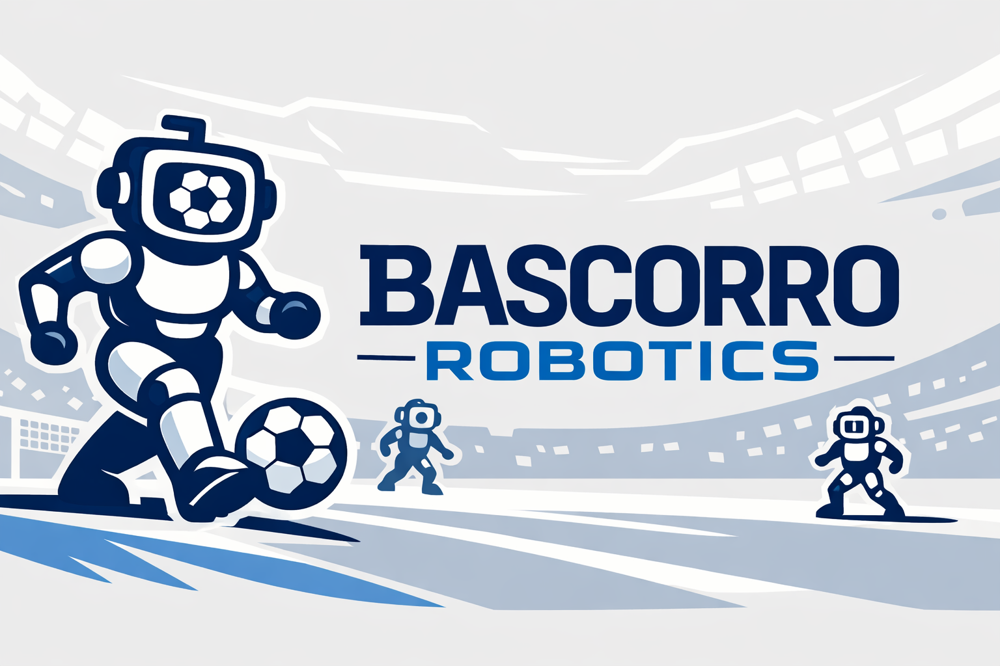

# Bascorro Studio

**Bascorro Studio** is the mission control dashboard for the Bascorro OP3 humanoid robot. It provides a modern, responsive web interface for telemetry, vision processing, parameter tuning, and complex motion editing.

Built with **React**, **Tailwind CSS**, and **ROS 2 Humble**, it serves as the primary interface for operating and debugging the robot during development and competition.



## ✨ Features

### 1. Mission Dashboard
The central hub for robot health and safety.
- **Real-time Telemetry**: Monitor Battery voltage, CPU load, Memory usage, and Network latency.
- **Safety Controls**: Prominent **Emergency Stop** and **Init Pose** panic buttons.
- **Joint Load Analysis**: Live bar charts visualization of torque load on all 20 servos to prevent overheating.
- **IMU Status**: Real-time roll/pitch/yaw orientation and fall state detection.

### 2. Vision Center
Dedicated interface for the `soccer_vision` system.
- **Live Stream**: Low-latency video feed from the robot's camera.
- **YOLO Tuning**: Adjust confidence thresholds for Ball, Goalpost, and Robot detection on the fly.
- **Snapshots**: Capture frames for dataset collection.

### 3. Tuning & Teleop
Tools for configuring locomotion and testing input.
- **Virtual Gamepad**: Visual feedback for physical controller inputs (ROS `/joy`).
- **Walking Parameters**: Dynamic tuning of X/Y amplitude, turn angle, and period.
- **Manual Parameters**: Direct access to set any ROS 2 node parameter.

#### Acuan angka Walking: page 2 (ALPHONSE)

Tab **Walking** secara default menampilkan offset sebagai **Δ terhadap acuan
page 2 / Walking Ready**. Ini perubahan koordinat angka UI, bukan kalibrasi
sendi atau perubahan gait. Tombol **Nilai asli ROS** mengembalikan tampilan
angka lama tanpa menerbitkan perintah atau mengubah draft.

Rumus: `angka tampilan = nilai asli ROS - acuan`; saat operator mengedit,
`nilai asli ROS = angka tampilan + acuan`. Kolom Current menggunakan rumus
yang sama terhadap hasil Load terakhir, bukan terhadap draft.

| Field | Nilai asli ROS yang ditampilkan sebagai 0 |
|---|---:|
| `init_x_offset` | -0.02 m |
| `init_y_offset` | 0 m |
| `init_z_offset` | 0.0408 m |
| `init_roll_offset` | 0 rad |
| `init_pitch_offset` | -0.07 rad |
| `init_yaw_offset` | 0 rad |
| `hip_pitch_offset` | 0.1396 rad |

Acuan tetap ini disimpan di `web/src/walkingPoseReference.js`, berdasarkan
konfigurasi ALPHONSE pada 11 September 2026. Y sengaja **bukan 0.028**:
`computeNeutralLegAngle(..., false)` mengeluarkan Y dari perhitungan bias,
jadi Y sudah berupa tambahan lebar terhadap stance yang ditangkap.
Contoh: ROS `init_x_offset=-0.03` terlihat sebagai `-0.01`, sedangkan
`init_y_offset=0.028` tetap terlihat sebagai `0.028`.

Load, Apply, Save to Robot, versi tersimpan (di disk robot), dan jalur simulasi tetap
memakai **nilai asli ROS**. Tidak ada migrasi preset atau penulisan otomatis
ke robot. Timing, amplitudo langkah, balance, pelvis, dan gain tidak digeser.
Kartu Walking Tuner di tab Tuning hanya mengedit amplitudo/period sehingga
angkanya juga tetap. **Untuk menyalin angka ke YAML atau terminal ROS, pilih
Nilai asli ROS terlebih dahulu**; jangan menyalin Δ sebagai nilai native.

Nol UI bukan jaminan pose fisik tepat page 2: modul walking masih menangkap
pose dan parameter yang aktif saat enable. Acuan tampilan ini tidak mengikuti
Load, Apply, atau pergantian preset dan tidak mengubah mekanisme tersebut.
Jangan mengganti acuan otomatis dengan runtime terkini atau hasil FK dari
page 2: itu memerlukan kajian bias/kinematika, bukan sekadar mengganti angka UI.

#### Versi Tersimpan: disimpan di DISK robot, bukan di browser

Sejak 2026-09-12 daftar versi walking disimpan di
`src/bascorro_studio/data/walking_versions.json`, dilayani oleh server Vite yang
sama yang menyajikan Studio (`web/server/studioStorePlugin.js`, dijalankan
`scripts/bascorro_studio.sh`). Sebelum tiap tulis, berkas lama disalin ke
`data/backup/` (200 salinan terakhir), jadi nilai yang tertimpa Save masih bisa
dipulihkan.

Urutan saat Studio dibuka: **baca disk -> periksa -> pulihkan versi yang
terakhir dipakai ke isian -> baru tampil**. Default hanya dipakai kalau memang
tidak ada versi aktif. Tidak ada yang dikirim ke robot saat Studio dibuka;
Apply tetap tombol operator.

Yang dulu membuat nilai tersimpan "berubah" atau "kembali ke default" sesudah
Studio dibuka ulang, dan penjaganya sekarang:

1. **Isian selalu mulai dari default.** `walkingParams` dibuat dari
   `WALKING_DEFAULT_PARAMS` dan versi terakhir tidak pernah diingat. Sekarang
   versi aktif dicatat di disk dan dipulihkan.
2. **Memilih versi tidak memuatnya, tapi Save menulis ke versi yang dipilih.**
   "Pilih JALAN MENUJU MEKKAH -> Save" menimpa MEKKAH dengan isi isian (default,
   atau nilai versi lain). Sekarang memilih = memuat; Save hanya menulis ke versi
   yang isinya sedang terbuka; nama lain = versi baru (versi lama tidak diganti
   nama); nama milik versi lain ditolak.
3. **localStorage penuh dan gagal diam-diam.** `localhost:5173` memakai 97,7%
   kuota 5 MiB (riwayat Action Editor ~4,5 MB). Saat penuh, `setItem` melempar
   dan galatnya ditelan: layar bilang "updated", disk tidak berubah. Berkas disk
   tidak berbagi kuota; Save baru dinyatakan berhasil sesudah server membaca
   ulang berkasnya dan nilainya cocok persis.
4. **localStorage terpisah per alamat/browser.** `localhost` dan IP berisi
   daftar berbeda. Berkas disk sama untuk semua alamat dan browser.
5. **Pilihan "Relatif page 2 / Nilai asli ROS" tidak diingat**, jadi angka yang
   sama terlihat lain sesudah dibuka ulang. Sekarang ikut tersimpan.
6. **Semaian preset menimpa versi bernama sama** (diperbaiki 36197e2).

Lencana di panel Versi Tersimpan memperlihatkan keadaannya: `✓ Sama dengan
"<versi>"` atau `● Belum disimpan ke "<versi>"`. Menutup Studio dengan isian
yang belum disimpan memunculkan pertanyaan browser. Kalau server penyimpanan
tidak terbaca, panel beralih ke baca-saja (Save/Delete mati) dengan pesan merah,
bukan diam-diam menyimpan ke tempat lain.

Log di konsol browser (F12): `[LOAD] ...` saat dibuka/memilih versi,
`[SAVE] ...` saat menyimpan, `[APPLY] ...` saat runtime mengonfirmasi. Log
server (`[walking-store] ...`) muncul di terminal `bascorro_studio.sh`.

`scripts/sync_preset_from_studio.py` membaca berkas disk ini (localStorage lama
hanya dengan `--dari-browser`). Logika penyimpanan diuji di
`web/test/walkingVersionFile.test.mjs` dan `web/test/walkingVersionStore.test.mjs`.

### 4. Action Studio
A powerful motion editor for creating and refining robot behaviors.
- **3D Preview**: WebGL-based visualization of the robot (URDF) mirroring the editor state.
- **Step-by-Step Editing**: Precise control over joint positions, pause times, and execution time.
- **Scratch Runner**: Test single steps or sequences instantly without saving.
- **YAML Management**: Import/Export actions compatible with `op3_action_module`.
- **Undo/Redo**: Full history support for safe editing.

### 5. System Logs
Searchable timeline of system events, errors, and warnings for post-mortem analysis.

---

## 🚀 Quick Start

### 1. Build the Workspace
Ensure you have the full ROS 2 Humble workspace set up.

```bash
colcon build --packages-select bascorro_studio
source install/setup.bash
```

### 2. Install Dependencies (First Run Only)
The web interface requires Node.js and pnpm.

Install pnpm:

Using PowerShell (Windows):

```powershell
Invoke-WebRequest https://get.pnpm.io/install.ps1 -UseBasicParsing | Invoke-Expression
```

On Windows, Microsoft Defender can significantly slow down installation of packages. You can add pnpm to Microsoft Defender's list of excluded folders in a PowerShell window with administrator rights by executing:

```powershell
Add-MpPreference -ExclusionPath $(pnpm store path)
```

On POSIX systems:

```bash
curl -fsSL https://get.pnpm.io/install.sh | sh -
```

If you don't have curl installed, you would like to use wget:

```bash
wget -qO- https://get.pnpm.io/install.sh | sh -
```

Then install Node LTS via pnpm:

```bash
pnpm env use --global lts
```

Finally, install the web dependencies:

```bash
cd src/bascorro_studio/web
pnpm install
cd ../../..
```

### 3. Launch Studio
Use the provided script to start the ROS bridge, backend agent, and web server.

```bash
./script.sh --studio
```

This launches:
- `rosbridge_server` (WebSocket <-> ROS 2)
- `studio_agent` (System metrics & backend logic)
- `asset_server` (Serves robot meshes/URDF)
- `vite` (Web UI)

Open **http://localhost:5173** in your browser.

---

## 🛠 Configuration

### Environment Variables
You can override default settings in your shell or `.bashrc`:

| Variable | Default | Description |
|----------|---------|-------------|
| `OP3_STUDIO_PORT` | `5173` | Web UI port |
| `OP3_ROSBRIDGE_URL` | `ws://localhost:9090` | ROS Bridge WebSocket URL |
| `OP3_STUDIO_ASSETS_PORT` | `8001` | Port for serving 3D assets |
| `OP3_STUDIO_SKIP_ROSBRIDGE` | `0` | Set `1` to manage rosbridge externally |

### Web Development
For frontend-only development with hot reload:

```bash
cd src/bascorro_studio/web
pnpm run dev
```

---

## 📡 ROS API

The studio interacts with the robot via standard ROS 2 topics and services.

### Published Topics
- `/robotis/base/ini_pose` (`std_msgs/String`) - Reset robot pose
- `/robotis/walking/command` (`std_msgs/String`) - Walking control
- `/robotis/walking/set_params` (`op3_walking_module_msgs/WalkingParam`) - Tuning
- `/robotis/action/page_num` (`std_msgs/Int32`) - Execute action page

### Subscribed Topics
- `/bascorro_studio/metrics` - Aggregated system telemetry
- `/bascorro_studio/events` - System event log
- `/robotis/present_joint_states` - Real-time joint feedback
- `/vision/yolo/debug` - Camera stream

---

## 🎨 Design System

Bascorro Studio follows the **UNDIP Robotics Design System**:
- **Primary Color**: UNDIP Blue (`#002060`)
- **Accent Color**: RoboCup Yellow (`#F4B400`)
- **Icons**: Lucide React
- **Styling**: Tailwind CSS
